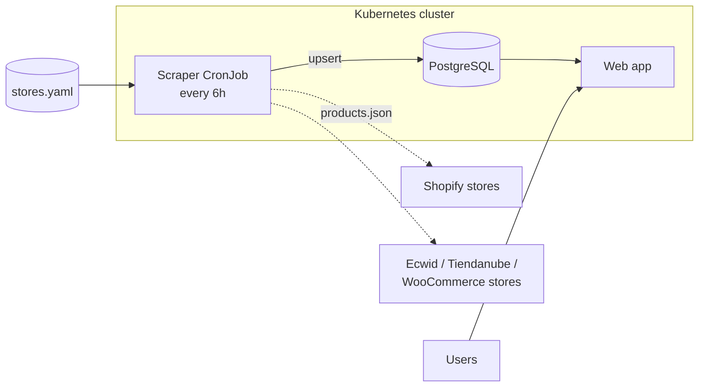

<div align="center">

# 👕 ropa-uy

**Every men's clothing store in Uruguay, in one place, searchable by style.**

A learning-first project for running a real system on Kubernetes,
from a home lab to the cloud.


</div>

---

## Why

Uruguayan men who want a particular style, such as urban, punk or
streetwear, usually find it only by already knowing the small brands on
Instagram. The big chains are easy to find. The independent labels are not.

**ropa-uy** reads the online catalogs of local stores, from small brands to
large chains, and brings them together so you can browse by style instead of
by store.

> **Project goals, in order**
> 1. Learn Kubernetes properly by building something real.
> 2. Keep it cheap enough that a small income from stores covers hosting.

## How it works



- **One reader per platform, not per store.** Most stores run on a handful
  of platforms, so adding a store is usually one line in `stores.yaml`.
- **Polite by design.** Rate-limited, follows `robots.txt`, and identifies
  itself with a contact URL.
- **Nothing is deleted.** Products that leave a store are marked removed, and
  only after a successful scrape.

## Roadmap

Each stage ends with a working site and adds new Kubernetes concepts.

| Stage | What gets built | What you learn |
|:-----:|-----------------|----------------|
| **1** | Shopify scraper, PostgreSQL, simple web app on **Azure AKS** (free tier) | Deployments, Services, CronJobs, ConfigMaps, Secrets, StatefulSets, PVCs |
| **2** | Queue and parallel workers, more platforms, Ingress, Helm charts | Scaling, Ingress, packaging with Helm |
| **3** | Style tagging, search engine, Prometheus + Grafana, Argo CD | Observability, GitOps |
| **4** | Product images on **AWS S3**, infra as code | Multi-cloud, Terraform |

**Current progress**

- [x] Stage 1 scraper design ([spec](docs/superpowers/specs/2026-11-07-scraper-design.md))
- [x] Stage 1 implementation plan ([plan](docs/superpowers/plans/2026-11-08-stage1-scraper.md))
- [x] Shopify scraper
- [x] AKS manifests (PostgreSQL + CronJob)
- [ ] AKS cluster and registry ([what to create](docs/infra.md))
- [ ] Web app

## Repository layout

```text
ropa-uy/
├── services/
│   ├── scraper/        # Python scraper (stage 1)
│   └── web/            # Web app (stage 1)
├── deploy/
│   └── aks/            # Kubernetes manifests (kubectl apply -k)
└── docs/
    └── superpowers/
        └── specs/      # Design documents
```

## Tech stack

| Layer | Choice |
|-------|--------|
| Language | Python 3.12 (`httpx`, `psycopg` 3, `PyYAML`, `pytest`) |
| Database | PostgreSQL |
| Orchestration | Azure Kubernetes Service (AKS) |
| Object storage | AWS S3 (stage 4) |

## Getting started

### Run the scraper on your machine

```bash
cd services/scraper
python -m venv .venv && .venv\Scripts\activate     # macOS/Linux: source .venv/bin/activate
pip install -r requirements-dev.txt
python -m pytest                                    # database tests run only with TEST_DATABASE_URL set
python -m scraper run --dry-run --store kaboa       # prints products as JSON, saves nothing
```

### Deploy to AKS

First create the infrastructure listed in [docs/infra.md](docs/infra.md), then:

| # | Command | What it teaches |
|---|---------|-----------------|
| 1 | `az aks get-credentials -g rg-ropa-uy -n aks-ropa-uy` | Points `kubectl` at your cluster |
| 2 | `az acr build -r <acr> -t ropa-uy-scraper:0.1.0 services/scraper` | Builds the image in Azure and stores it in your registry |
| 3 | Replace `ACR_NAME` in `deploy/aks/kustomization.yaml` | Kustomize rewrites image names without editing every file |
| 4 | `kubectl apply -f deploy/aks/namespace.yaml` | Namespaces group the project's objects |
| 5 | `kubectl -n ropa-uy create secret generic ropa-uy-db --from-literal=postgres-password=<pick one> --from-literal=database-url=postgresql://postgres:<same>@postgres:5432/postgres` | Secrets keep passwords out of Git |
| 6 | `kubectl -n ropa-uy create configmap scraper-stores --from-file=stores.yaml=services/scraper/stores.yaml` | ConfigMaps keep settings out of the image |
| 7 | `kubectl apply -k deploy/aks` | Creates PostgreSQL (with an Azure Disk) and the CronJob |
| 8 | `kubectl -n ropa-uy get pods -w` | Wait for `postgres-0` to be `Running` and `1/1` ready |
| 9 | `kubectl -n ropa-uy create job --from=cronjob/scraper scraper-manual-1` | Runs the CronJob now instead of waiting 6 hours |
| 10 | `kubectl -n ropa-uy logs -f job/scraper-manual-1` | Ends with `event=run_finished ok=1 failed=0` |
| 11 | `kubectl -n ropa-uy exec -it postgres-0 -- psql -U postgres -c "select store_slug, count(*) from products group by 1;"` | Checks the data landed |

In step 5, use only letters and digits in the password: it goes inside a URL, where characters like `@`, `:` or `/` break it.

To change the store list later: re-run step 6 with `--dry-run=client -o yaml | kubectl apply -f -` appended.

**Save money:** `az aks stop -g rg-ropa-uy -n aks-ropa-uy` when you're not using it, `az aks start` to resume.

## For store owners

ropa-uy reads only public catalog pages, sends each visitor straight to your
own store to buy, and follows your `robots.txt`. If you want your store
added, removed or corrected, please open an issue.

---

<div align="center">
<sub>Built in 🇺🇾 Uruguay, one Kubernetes concept at a time.</sub>
</div>
