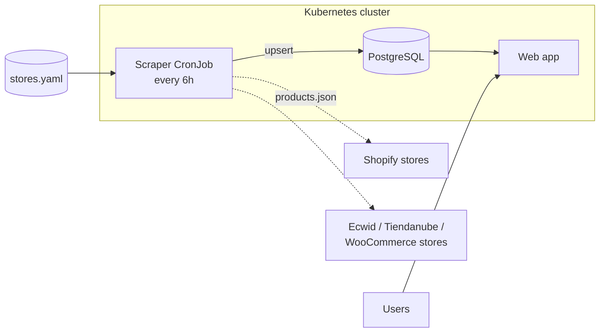

<div align="center">

# 👕 ropa-uy

**Every men's clothing store in Uruguay, in one place, searchable by style.**

A learning-first project for running a real system on Kubernetes,
from a home lab to the cloud.


</div>

---

## Why

Uruguayan men who want a particular style, such as urban, punk or
streetwear, usually find it only by already knowing the small brands on
Instagram. The big chains are easy to find. The independent labels are not.

**ropa-uy** reads the online catalogs of local stores, from small brands to
large chains, and brings them together so you can browse by style instead of
by store.

> **Project goals, in order**
> 1. Learn Kubernetes properly by building something real.
> 2. Keep it cheap enough that a small income from stores covers hosting.

## How it works



- **One reader per platform, not per store.** Most stores run on a handful
  of platforms, so adding a store is usually one line in `stores.yaml`.
- **Polite by design.** Rate-limited, follows `robots.txt`, and identifies
  itself with a contact URL.
- **Nothing is deleted.** Products that leave a store are marked removed, and
  only after a successful scrape.

## Roadmap

Each stage ends with a working site and adds new Kubernetes concepts.

| Stage | What gets built | What you learn |
|:-----:|-----------------|----------------|
| **1** | Shopify scraper, PostgreSQL, simple web app on local **k3s** | Deployments, Services, CronJobs, ConfigMaps, Secrets, StatefulSets, PVCs |
| **2** | Queue and parallel workers, more platforms, Ingress, Helm charts | Scaling, Ingress, packaging with Helm |
| **3** | Style tagging, search engine, Prometheus + Grafana, Argo CD | Observability, GitOps |
| **4** | Move to **Azure AKS** (free tier), product images on **AWS S3** | Managed Kubernetes, multi-cloud |

**Current progress**

- [x] Stage 1 scraper design ([spec](docs/superpowers/specs/2026-11-07-scraper-design.md))
- [ ] Stage 1 implementation plan
- [ ] Shopify scraper
- [ ] k3s manifests (PostgreSQL + CronJob)
- [ ] Web app

## Repository layout

```text
ropa-uy/
├── services/
│   ├── scraper/        # Python scraper (stage 1)
│   └── web/            # Web app (stage 1)
├── deploy/
│   └── k3s/            # Kubernetes manifests for the home lab
└── docs/
    └── superpowers/
        └── specs/      # Design documents
```

## Tech stack

| Layer | Choice |
|-------|--------|
| Language | Python 3.12 (`httpx`, `psycopg` 3, `PyYAML`, `pytest`) |
| Database | PostgreSQL |
| Orchestration | k3s at home, then Azure Kubernetes Service |
| Object storage | AWS S3 (stage 4) |

## Getting started

> 🚧 Code arrives with stage 1. Setup steps will be added here once the
> scraper runs.

## For store owners

ropa-uy reads only public catalog pages, sends each visitor straight to your
own store to buy, and follows your `robots.txt`. If you want your store
added, removed or corrected, please open an issue.

---

<div align="center">
<sub>Built in 🇺🇾 Uruguay, one Kubernetes concept at a time.</sub>
</div>
